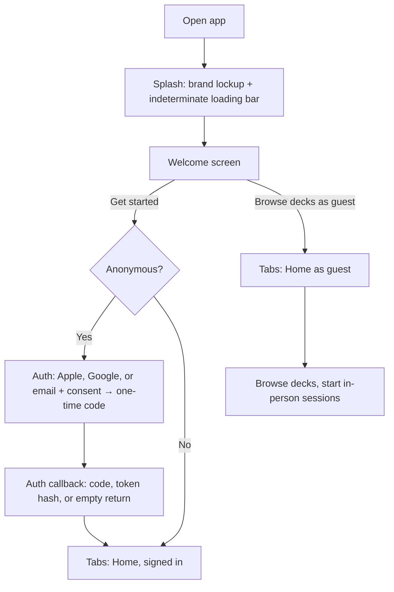

# User Flows
## Chale

This document maps the key journeys through the app at a behavioral level — screens and decisions, not visuals (see `05-design-system.md` for that). Each flow is the spec for that feature; if implementation needs to deviate, update this doc first.

> **This doc was rewritten 2026-10-13 from the shipped code** (screen-by-screen audit; route-by-route notes in `question-page-brief.md`). It supersedes the earlier version, which described a single global mode of play. The shipped product has two: **remote** (the same deck of question cards, apart — answers passed as text or voice, paced one card per connection per day) and **in-person** (a two-people-one-phone session through a deck, no answering). Remote is not a separate "question a day" product — it is the in-person card experience for people who are apart. Push notifications are not shipped and are marked as such below; plan work lives in `03-roadmap.md`.

---

## 1. Onboarding, guest browsing & account creation



Notes:
- Auth is deferred, not eliminated: first launch anonymously signs in via Supabase anonymous sign-in, and every guest gets a `users` row ("New friend"). The account boundary sits at the first action that needs to persist to a person — creating/joining a connection, or saving a favourite.
- Guests can browse the whole catalogue (`/decks`, `/deck/[id]`) and play in-person sessions without an account. Toggling a favourite routes them to `/auth` — favourites, answers and connections are account-only.
- Account creation is a **method ladder**: Apple (iOS only, official button, rendered only where `isAvailableAsync()` is true), Google (secondary row with the globe glyph), then email one-time code below an "or" divider. Name is collected after verification and is optional; it feeds the greeting on Home.
- Social sign-in links the anonymous identity in place, so guest favourites survive the upgrade; where the provider identity already belongs to another account, the app signs in separately and says so in place. Email claiming keeps the anonymous user id via the same rule as before. Cancelled Apple sheets and dismissed browsers return silently — cancellation is not failure.
- Returns land on the `auth-callback` route: `?code=` (PKCE, exchanged in place), `?token_hash=` + `?type=` (emailed link via the hosted bridge), or neither (OAuth-link return — the session never left, nothing to exchange). A failed link renders a retryable error card with a way back.
- The account boundary carries an age consent: "Send code" stays disabled until the user checks "I'm 13 or older / a parent or guardian agrees if you're under 16" — the same rule as the Terms. The gate stays **email-only for now** (social methods do not ask for it); extending or unifying the gate is a flagged follow-up, not a silent drop. Guests never see this gate; it only exists on the account-creation path.
- After verifying, the user lands back where they were (`/auth` is a push, dismissed on success).

## 2. In-person session ("together" mode)

```mermaid
flowchart TD
    A[Decks storefront] --> B[Tap a deck: DeckSheet]
    B --> C[Play: Together]
    C --> D[/session?pack=]
    D --> E[Device shuffle: seeded pack order, slice for this pack cursor]
    E --> F[Question card: index/total, favourite, Previous, Next]
    F --> F
    F -->|Last card| G{A way out}
    G -->|Back home| H[Back home: advance cursor + resumable slot cleared]
    G -->|Draw the next 20| I[Next session of the same deck, same screen]
    H --> J[Home: NextUpCard offers the same deck — N fresh left]
    F --> K[Start this deck over: same slice again]
```

Notes:
- Two people, one phone, in a room. **No answers, no reveal, no server-side state** — the question IS the activity. Guests can play this; no connection or account is required.
- **The seed model (2026-10-14):** the pack's active questions are fetched once and shuffled on-device with a per-pack seed (`chale.shuffle.v1.<packId>` = seed + cursor). Session k is slice k of that shuffle, so a deck's sessions never repeat a question until the cycle is exhausted — `draw_session_questions`'s `order by random()` was making every session an independent draw with repeats possible. The cursor advances on both endings; "N fresh left" is arithmetic, not a ledger. A tail is honestly short (65 → 20, 20, 20, 5); the session after a tail is a fresh shuffle, eyebrow-announced. Design: `docs/superpowers/specs/2026-10-14-deck-sessions-design.md`.
- The position and draw are cached in the React Query cache and mirrored to AsyncStorage (`chale.session.v1.<packId>`), so leaving and returning resumes on the same question, and Home's resume tray offers half-finished sessions (discardable).
- The last card offers two exits: **Back home** (advance the cursor, clear the slot; the pack next opens at slice k+1) and **Draw the next 20** (advance the cursor, stay on the screen, deal the next session — with the last session of a cycle offering a *fresh shuffle* instead).
- Home's recommendation slot: the pairing-invite card holds the position until a connection is linked or the user dismisses it once; once dismissed, the slot shows **NextUpCard** — the deck most recently completed here ("Keep going — N fresh left"), else a default Friends deck ("Start here"). This is distinct from ResumeCarousel, which tracks half-finished sessions.
- The favourite toggle works here and on the remote side — one `favourites` table behind the Favourites tab. Guests tapping it get routed to `/auth` first.
- Mid-session, "Start this deck over" re-deals the same slice from index 0 (cursor unchanged). Resuming a deck is per-deck: a shared phone can hold sessions on several decks at once.
- This mode is not described by the PRD or this doc's earlier versions — it came from design work (archived in `docs/archive/`) and shipped as a first-class mode.

## 3. Pairing & remote setup

```mermaid
flowchart TD
    A[DeckSheet: Play: Remotely] --> B[/start with deck pinned]
    C[Home daily card, no connection] --> B
    B --> D{Anonymous?}
    D -->|Yes| E[Create account to continue -> /auth]
    D -->|No| F[Generate my invite code]
    F --> G[Share link: join?code=XXXXXX]
    G --> H[Pending: invite out, code stays on screen]
    I[Other person opens link] --> J[/start with code pre-filled]
    J --> K[Join with code]
    H --> L[Connection linked]
    K --> L
    L --> M[Land on the remote tab - today's question]
```

Notes:
- The account boundary is here, not at launch: creating or joining a connection requires the email OTP account.
- **One invite at a time.** Re-entering `/start` while an invite is pending reuses the existing code — generating a second would strand whoever was sent the first.
- Relationship type is asked once, at connection setup (picker exists, MVP only offers "Partner").
- **The inviter's deck is pinned to the connection** (`connections.active_deck_id`), so the remote draw comes from the deck that was being browsed — not from whatever the relationship type happens to match. Joining with a code adopts the inviter's deck.
- Pending invites block nothing else: Home shows the daily card as "invite-pending" rather than "no partner", and remote questions only exist for `linked` connections.

## 4. Remote card — answering

```mermaid
flowchart TD
    A[Open app / Remote tab] --> B{Linked connection?}
    B -->|No| C[Start with your person panel -> /start]
    B -->|Yes| D{Today's prompt exists?}
    D -->|No| E[Prompt created for today - one per calendar day]
    D -->|Yes| F[Question card + AnswerPanel]
    E --> F
    F --> G[Answer type: text, voice, or either - set by the question]
    G -->|Text| H[Type + submit]
    G -->|Voice| I[Record, preview, upload + submit]
    H --> J{Partner answered?}
    I --> J
    J -->|No| K[WaitingState - you have answered, nothing about them]
    J -->|Yes| L[Open reveal -> /prompt/[id]]
```

Notes:
- The server paces remote play at one card per connection per calendar day (`get_or_create_today_prompt`). Home only ever *peeks* (`read_today_prompt`) — browsing the dashboard never spends the day's card; the prompt is created when the remote flow actually opens. Pacing is the mechanism, not the product: the experience is a deck of question cards worked through apart, exactly as the in-person mode is a deck worked through together.
- **Answers stay editable until the reveal.** Re-submitting replaces the current answer (and resets any save flag on it). The instant the second person submits, `reveal_state` flips to `revealed` — server-side, non-negotiable — and both answers lock. This supersedes the old "own answer is never editable" note; the integrity guarantee is the reveal, not immutability.
- The WaitingState confirms *you* answered and reveals nothing about the other person's progress.
- Home flips to the reveal state in realtime (answers subscription) — the moment both have answered. It also re-checks on focus, because tabs don't unmount.
- Voice answers are an upload followed by a submit; if the submit fails the recorded clip is **kept** on screen — losing someone's answer is the worst thing the screen can do.
- No push notification anywhere in this loop. Opening the app is the only wake-up (see §7).

## 5. Reveal moment

```mermaid
flowchart TD
    A[Both answers submitted] --> B[reveal_state: revealed - server-side]
    B --> C[Open app -> reveal state on Home/Remote]
    C --> D[/prompt/[id]: side-by-side answers]
    D --> E{Either answer a voice clip?}
    E -->|No| F[Both texts shown - done]
    E -->|Yes| G[Clips playable; listening is recorded per (answer, listener)]
    G --> H{Both have listened?} 
    H -->|No| I[Refresh nudge until listens land]
    H -->|Yes| J[Speaker-only prompt: save this one?]
```

Notes:
- The reveal is deliberate but adds no taps: once both have answered, Home and Remote both lead straight to `/prompt/[id]`.
- Side-by-side answers, yours and theirs, both types playable/readable in place.
- Reveal readiness rides the realtime answers subscription; remote voice-save eligibility is polled every 5 seconds (`voice_listens` has no realtime channel yet).

## 6. Voice lifecycle (walkie-talkie rules)

| Stage | Rule |
|---|---|
| Recording | Press to start/stop, preview, re-record before sending |
| Send | Upload to storage, then submit the answer row |
| Listening | A listen is a row in `voice_listens`, unique per (answer, listener) — each person's first play counts, replays don't |
| Save prompt | Appears to the **speaker only**, once `listens >= 2` (both people have listened) and the clip isn't saved yet. "Not now" hides it for the visit |
| Saved | Clip flagged `saved`, exempt from expiry — this is the one clip you keep |
| Expiry | 7-day backstop from submission (`expires_at`); even unlistened clips are deleted after it |

Notes:
- The rule is per-speaker honesty: a speech-shaped answer can't be quietly archived by the speaker alone — the listener has to have heard it, and the save decision is theirs to make, to the speaker, once both have listened.
- The save prompt and the "you can save this" copy appear on `/prompt/[id]`; listening from Home doesn't count, only the reveal screen's players (listens are recorded when a clip is played, wherever that is).

## 7. Notifications

**None are shipped.** `expo-notifications` is not a dependency and there is no device token or scheduler. This doc's previous notifications table was aspirational; the actual state:

| Trigger | Status |
|---|---|
| New card ready | Not shipped — opening the app is the trigger |
| Partner submitted their answer | Not shipped |
| Reveal ready | Not shipped (realtime only works while the app is open) |
| Connection invite accepted | Not shipped |
| Streak reminders (v1.1) | Not planned until `03-roadmap.md` Phase 5 |

The Settings screen's Notifications switch is a local UI toggle with no backing service — do not read it as "notifications exist".

## Invariants (load-bearing)

- **Reveal is server-side.** `reveal_state` is only ever set by an answer submission, never by a timer or by the client.
- **One prompt per connection per calendar day**, drawn from the connection's active deck.
- **Home never creates the prompt**; only the remote flow does.
- **A pending invite is not a partner.** Home/remote treat `pending` and "no connection" as different states.
- **Exactly two people per connection.** The reveal rule, the voice rule and the invite model all assume this.
- **Answers editable until reveal, immutable after.**
- **The invite code is stable** while pending; one live invite per connection.
- **Voice save is speaker-only and listen-gated; expiry is absolute at 7 days.**

## Open questions

All previously-open questions are resolved:
- *Rollover vs midnight* — resolved: one prompt per calendar day; an unanswered question does not roll over.
- *Voice backstop window* — resolved: 7 days from submission.
- *Pairing permanence* — resolved for beta: connections are permanent; an unjoined invite simply stays pending (no cancel/unlink flow built).
