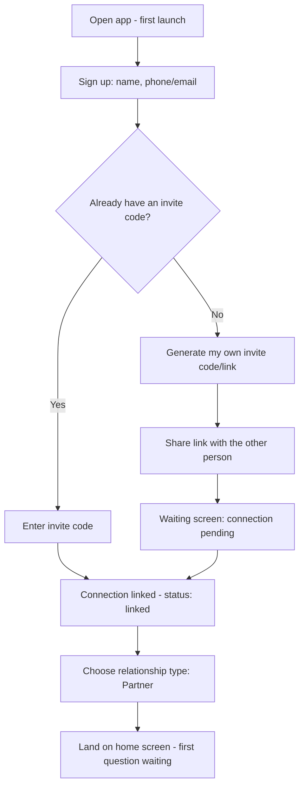
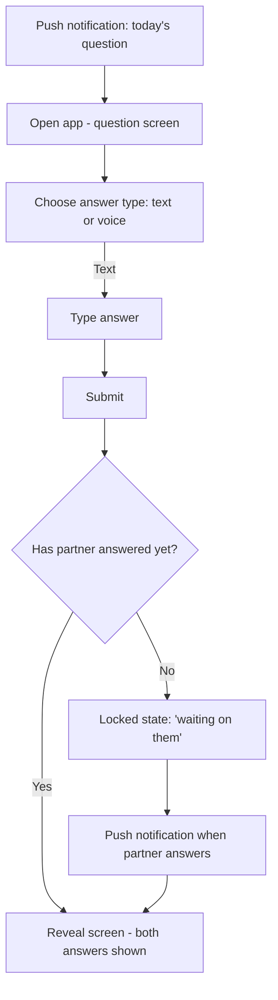
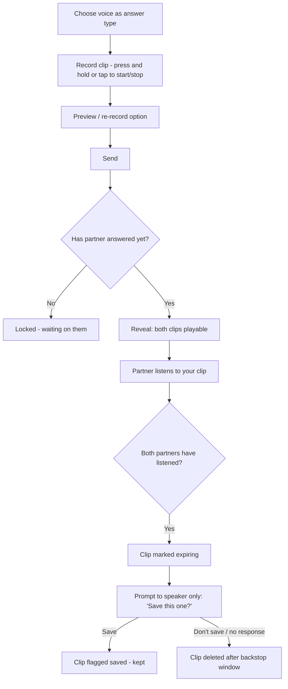
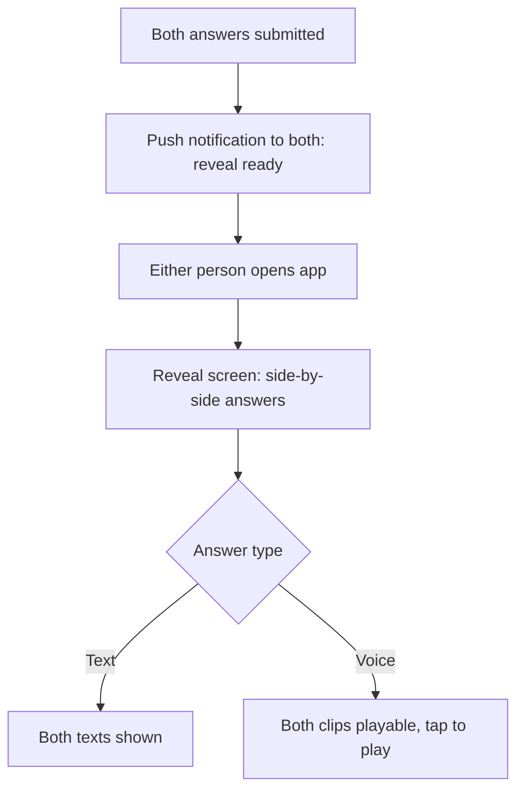

# User Flows
## Chale

This document maps the key journeys through the app at a behavioral level — screens and decisions, not visuals (see `05-design-system.md` for that). Each flow should be treated as the spec for that feature; if implementation needs to deviate, update this doc first.

---

## 1. Onboarding & account creation

Notes:
- Relationship type is asked once, at connection setup, not per-question.
- MVP only exposes "Partner" as a selectable type (see PRD §5) — the picker UI should still exist so adding types later doesn't require a new screen.
- "Waiting screen" should clearly communicate what's blocking (the other person hasn't joined yet) rather than reading as a stalled/broken state.

## 2. Daily question — text answer

Notes:
- Once submitted, a user's own answer is never editable — this preserves the integrity of the "locked until both answer" mechanic (see `02-technical-architecture.md`, reveal logic).
- The "waiting on them" state should show that *you've* answered (confirmation), without revealing anything about whether the other person has started.

## 3. Daily question — voice answer ("walkie-talkie mode")

Notes:
- The save prompt appears only to the **speaker**, after **both** people have listened — never before, and never to the listener (see `02-technical-architecture.md` for why: this keeps the in-the-moment answer honest rather than performed for an archive).
- If one partner never listens, a backstop expiry (e.g. 7 days) still deletes the clip — this prevents an unlistened clip from lingering indefinitely and blocking the save decision from ever resolving.

## 4. Reveal moment

Notes:
- This is the emotional payoff moment the whole mechanic is built around — it should feel deliberate (a brief transition/animation) rather than instant, but shouldn't add friction (no extra taps required to see the reveal once both have answered).

## 5. Notifications overview

| Trigger | Recipient | Purpose |
|---|---|---|
| New daily question available | Both | Start the loop |
| Partner submitted their answer | The other person | Gentle nudge, not a reveal |
| Reveal ready (both answered) | Both | The payoff moment |
| Connection invite accepted | Inviter | Confirms pairing succeeded |
| (v1.1) Streak about to lapse | Both | Retention nudge |

## Open questions to resolve before building these flows in full

- Does an unanswered question roll over to the next day, or expire at midnight? (Affects step E/F in flow 2 and the "daily ritual" feel — flagged in `01-prd.md` §9, still open.)
- Exact voice clip backstop expiry window (7 days suggested in `02-technical-architecture.md` — not yet confirmed as final).